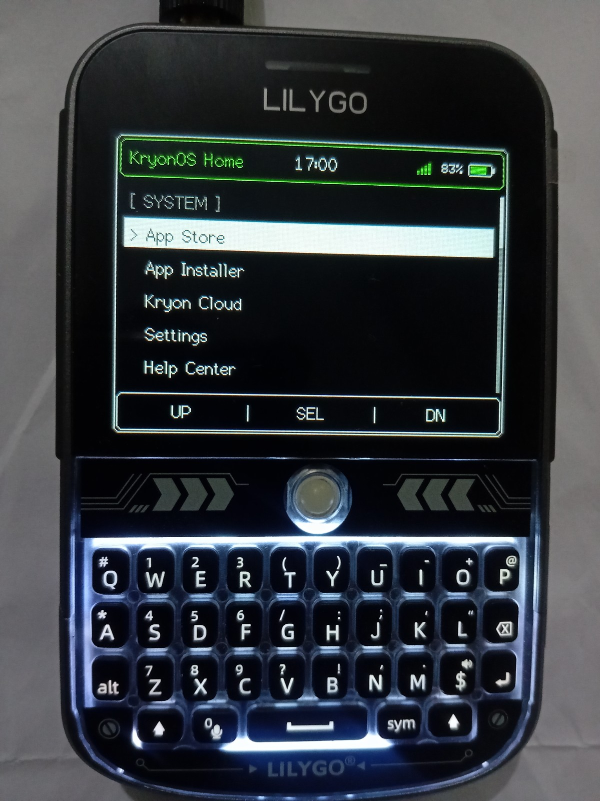
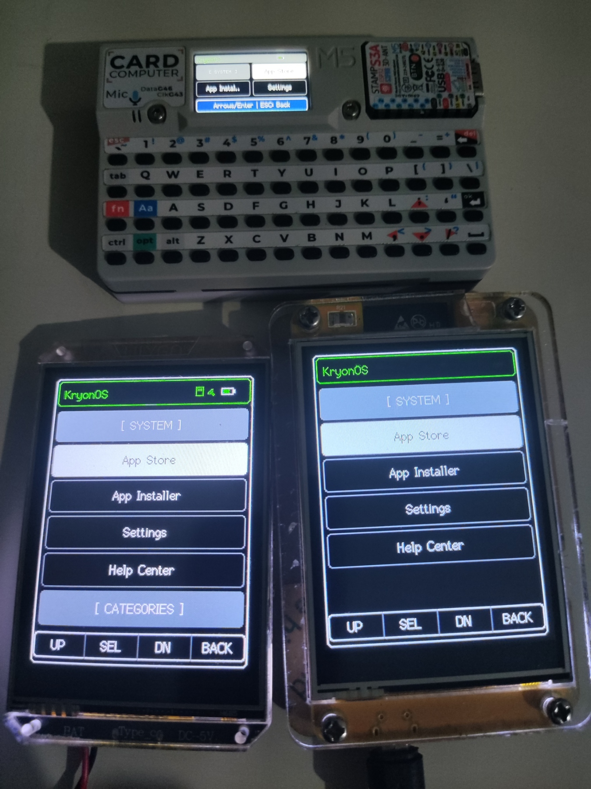
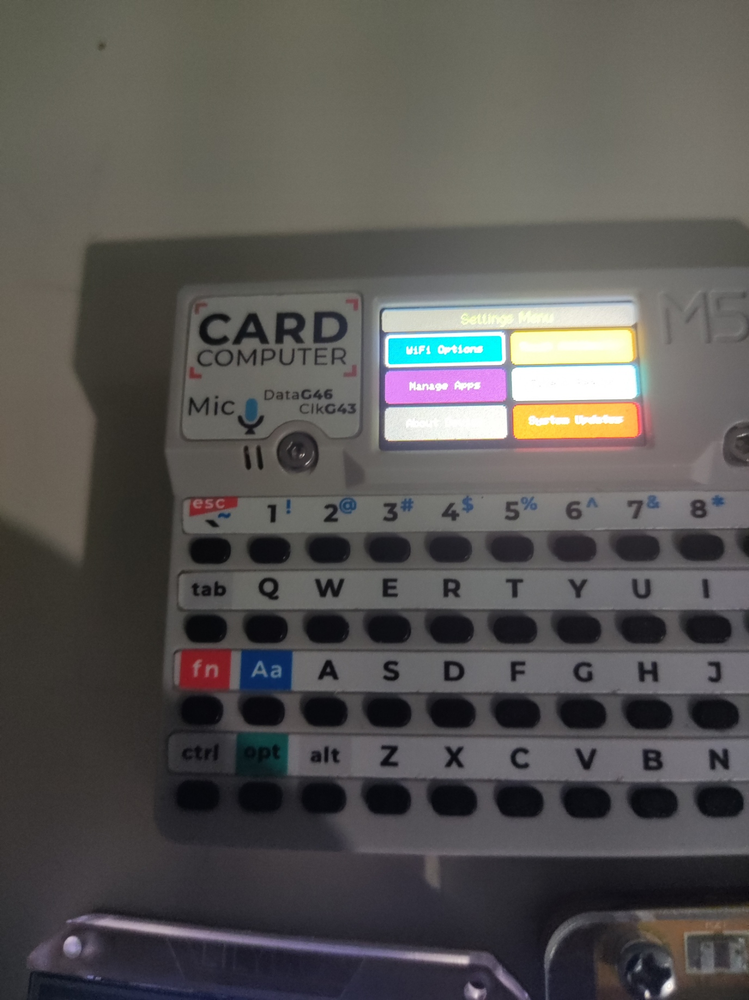
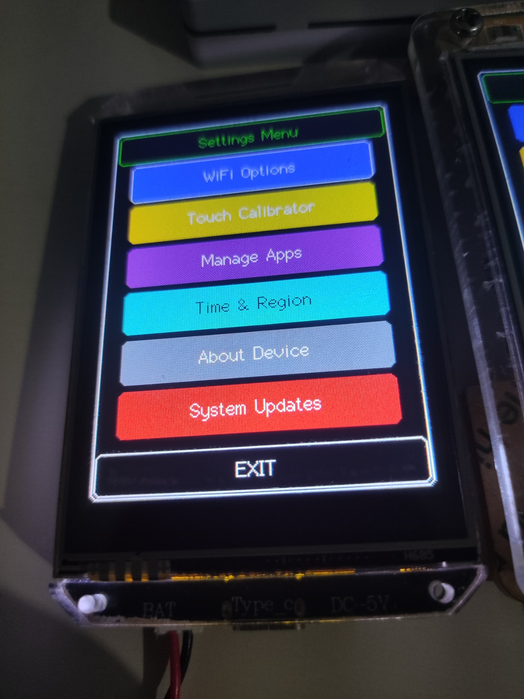
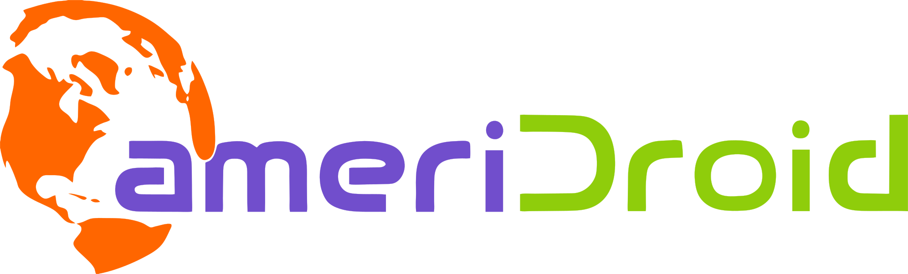

<h1>KryonOS</h1>

  <strong>A GUI JavaScript OS for ESP32</strong>

  An open-source GUI operating system and JavaScript app platform for ESP32 and ESP32-S3, with graphics, hardware APIs, file management, an App Store, and cloud services.

  
  
  

  <a href="https://github.com/Haris16-code/KryonOS/wiki">Documentation</a>
  •
  <a href="https://github.com/Haris16-code/KryonOS/releases">Releases</a>
  •
  <a href="https://github.com/Haris16-code/KryonOS/discussions">Discussions</a>
  •
  <a href="https://github.com/Haris16-code/KryonOS/issues">Issues</a>

 

  <strong>Support KryonOS Hardware Development</strong>

  Help support KryonOS development by contributing toward the hardware, boards, and resources needed for development, testing, and official board support.

  
  
  

  

  

  Funds will help support KryonOS development and testing, including acquiring
  development boards and hardware needed for new features, compatibility, and official board support.

KryonOS is an <strong>open-source</strong>, lightweight, high-performance <strong>GUI Operating System and JavaScript App Runtime</strong> designed specifically for the ESP32 and ESP32-S3 microcontrollers. It provides a complete desktop-like experience on embedded devices, featuring an integrated JS engine (Duktape) for executing standalone JavaScript applications, double-buffered graphics for smooth 2D/3D rendering, KryonCloud services, on-device AI streaming, an App Store, file management, and direct hardware API access.

<table align="center">
  <thead>
    <tr>
      <th align="center">LilyGO T-Deck Plus Tested, Verified, and Stable</th>
      <th align="center">Multiple Devices Running KryonOS</th>
      <th align="center">M5Stack Cardputer v1.1 Experimental</th>
      <th align="center">LilyGO T-HMI Experimental</th>
    </tr>
  </thead>
  <tbody>
    <tr>
      <td align="center">
        
      </td>
      <td align="center">
        
      </td>
      <td align="center">
        
      </td>
      <td align="center">
        
      </td>
    </tr>
  </tbody>
</table>

<h2>Features</h2>

<ul>
  <li><strong>JavaScript App Runtime (API Level 3):</strong> Execute interactive, standalone JavaScript applications natively on ESP32 using the optimized Duktape ECMAScript engine, with expanded hardware integration and new JavaScript APIs.</li>

  <li><strong>LilyGO T-Deck Plus Support:</strong> Dedicated hardware profile with support for the ST7789 display, GT911 touch controller, physical keyboard, trackball, MicroSD card, battery monitoring, and peripheral power management.</li>

  <li><strong>On-Device AI Image Generation Engine:</strong> Generate images directly on supported ESP32-S3 devices using the integrated 4.0-million-parameter DCGAN-96 neural image generation model.</li>

  <li><strong>Complete Bluetooth Subsystem:</strong> Comprehensive Bluetooth support with JavaScript APIs for BLE scanning, GATT client and server operations, advertising, and BLE HID keyboard functionality.</li>

  <li><strong>Global GPS Subsystem:</strong> Integrated GPS functionality with JavaScript APIs, location tracking, GPS settings, geodesy calculations, and automatic time synchronization.</li>

  <li><strong>Native Audio Engine:</strong> Built-in MP3 audio playback engine, WAV support, and expanded JavaScript audio APIs for audio-enabled applications and hardware.</li>

  <li><strong>Advanced Image Rendering:</strong> Native PNG, JPEG, and BMP image decoding and rendering, enabling image-based applications, viewers, and graphical interfaces.</li>

  <li><strong>Secure MicroSD Backup &amp; Disaster Recovery:</strong> Complete internal storage backup and restoration with AES-256-CBC encryption, HMAC-SHA256 integrity verification, device-locked protection, and passphrase-protected backups.</li>

  <li><strong>Expanded Hardware JavaScript APIs:</strong> Dedicated JavaScript interfaces for Trackball, Keyboard, Speaker, and Device functionality, enabling applications to interact directly with supported hardware.</li>

  <li><strong>Advanced Filesystem APIs:</strong> Expanded JavaScript file management with binary and chunk-based reading, binary writing, file copying, file statistics, directory removal, and SD card mount detection.</li>

  <li><strong>Responsive Display Framework:</strong> Improved UI architecture with responsive layouts and support for both portrait and landscape display orientations.</li>

  <li><strong>KryonCloud Services &amp; On-Device AI Integration:</strong> Cloud-connected AI capabilities through <code>Kryon.ai</code> and <code>System.ai</code>, including real-time token streaming (<code>SSE</code>), structured JSON extraction, and vision processing.</li>

  <li><strong>KryonBeam Mesh Messenger:</strong> Hardware-to-hardware communication across paired devices with broadcast and direct messaging channels.</li>

  <li><strong>Kryon3D Graphics Rasterizer:</strong> Native 3D graphics functionality through <code>Kryon3D</code> and <code>System.graphics3d</code>, supporting wireframes, solid shaded polygon meshes, camera controls, lighting vectors, and distance fog.</li>

  <li><strong>FastMath Acceleration Engine:</strong> Optimized mathematical operations through <code>FastMath</code> and <code>System.math</code>, including FPU-accelerated trigonometry, pre-computed 360-degree lookup tables, and hardware True Random Number Generation (<code>TRNG</code>).</li>

  <li><strong>Anti-Rollback Wireless OTA Updater:</strong> Secure firmware updates with manifest resolution, streaming 4KB chunk flashing, integrity verification, and automatic bootloader rollback recovery.</li>

  <li><strong>Rich UI &amp; Graphics Framework:</strong> Built-in graphics library with double-buffering, mini-sprite support, and improved rendering performance for responsive, flicker-free interfaces.</li>

  <li><strong>App Store &amp; Cloud Marketplace:</strong> Browse, download, and install JavaScript applications and games dynamically over Wi-Fi, with improved package integrity verification and API compatibility checks.</li>

  <li><strong>File Management &amp; Multi-Bus Storage:</strong> Integrated file explorer and text editor with LittleFS internal storage and external MicroSD/SD_MMC support.</li>

  <li><strong>Hardware-Backed Security Architecture:</strong> Silicon-based cryptographic support, encrypted credential storage, TLS certificate verification, JavaScript runtime sandboxing, application permissions management, and authenticated Web Management.</li>

  <li><strong>Expanded System Applications &amp; Diagnostics:</strong> New built-in applications, development examples, and diagnostic utilities for Bluetooth, GPS, audio, images, filesystems, T-Deck Plus hardware, and JavaScript APIs.</li>
</ul>

<h2>Supported Hardware</h2>

<table border="1" cellpadding="6" cellspacing="0">
  <thead>
    <tr>
      <th>Hardware Target</th>
      <th>Status</th>
      <th>Microcontroller</th>
      <th>Flash &amp; PSRAM</th>
      <th>Display Driver</th>
      <th>Input Mechanism</th>
    </tr>
  </thead>
  <tbody>
    <tr>
      <td><strong>T-Deck / Plus</strong></td>
      <td><strong>Default / Stable</strong></td>
      <td>ESP32-S3</td>
      <td>16MB Flash, 8MB Octal PSRAM</td>
      <td>ILI9341 240x320 SPI</td>
      <td>XPT2046 Touch</td>
    </tr>
    <tr>
      <td><strong>ESP32-S3 DevKitC-1</strong></td>
      <td><strong>Stable</strong></td>
      <td>ESP32-S3</td>
      <td>16MB Flash, 8MB Octal PSRAM</td>
      <td>ILI9341 240x320 SPI</td>
      <td>XPT2046 Touch</td>
    </tr>
    <tr>
      <td><strong>M5Stack Cardputer v1.1</strong></td>
      <td><em>Experimental</em></td>
      <td>ESP32-S3 (Stamp-S3)</td>
      <td>8MB Flash (Dual OTA)</td>
      <td>ST7789V2 240x135 SPI</td>
      <td>56-Key Physical Matrix Keyboard</td>
    </tr>
    <tr>
      <td><strong>LilyGO T-HMI</strong></td>
      <td><em>Experimental</em></td>
      <td>ESP32-S3</td>
      <td>16MB Flash, 8MB Octal PSRAM</td>
      <td>ST7789 240x320 8-Bit Parallel</td>
      <td>XPT2046 Touch &amp; SD_MMC</td>
    </tr>
  </tbody>
</table>

<strong>Note on Experimental Boards (M5Stack Cardputer, LilyGO T-HMI):</strong> Target boards marked as <em>Experimental</em> are implemented at the driver and HAL level but currently lack hands-on physical verification due to unavailable test hardware. If you test or flash KryonOS on these boards and encounter any issues or calibration offsets, please submit an issue on GitHub. Community feedback and contributions for these devices are strongly encouraged!

<blockquote>
  
<strong>ESP32-S3 N16R8 Setup:</strong> For wiring schematics, PSRAM configuration, and PlatformIO setup for the default reference board, see the <strong><a href="Documentation/ESP32_S3_N16R8_Guide.md">ESP32-S3 N16R8 Guide</a></strong>.

  
<strong>Multi-Board Architecture:</strong> For pinout tables and build configurations across all supported boards, see the <strong><a href="Documentation/Hardware_Architecture.md">Hardware Architecture Guide</a></strong>.

</blockquote>

<h2>How to Flash</h2>

<h3>Option 1: Using Precompiled Binaries</h3>

You can download the latest precompiled firmware <code>.bin</code> files directly from our <a href="https://github.com/Haris16-code/KryonOS/releases">Releases Page</a>.

Use an ESP32 flasher tool (such as <code>esptool.py</code> or the official ESP Flash Download Tool) to write the binaries:

<pre>esptool.py --chip esp32s3 --port COM14 --baud 921600 write_flash -z \
  0x0 bootloader.bin \
  0x8000 partitions.bin \
  0xe000 boot_app0.bin \
  0x10000 firmware.bin</pre>

<h3>Option 2: Build &amp; Flash via PlatformIO</h3>

To compile and flash from source:

<pre># 1. Clone repository
git clone https://github.com/Haris16-code/KryonOS.git
cd KryonOS

# 2. Build &amp; Upload for Default Board (ESP32-S3 DevKitC-1 N16R8)
pio run -e lilygo-t-deck -t upload
  

# Or compile for other boards:
pio run -e esp32-s3-devkitc-1-n16r8 -t upload  # ESP32 S3 N16R8 DevKit
pio run -e m5stack-cardputer -t upload   # M5Stack Cardputer
pio run -e lilygo-t-hmi -t upload        # LilyGO T-HMI
</pre>

<h2>Documentation</h2>

<table>
  <tr>
    <td><a href="Documentation/Hardware_Architecture.md"><strong>Hardware Architecture</strong></a></td>
    <td>Hardware configuration and system architecture.</td>
  </tr>
    <tr>
    <td><a href="https://github.com/Haris16-code/KryonOS/wiki/How-To-Setup-KryonCloud"><strong>Setup Your KryonCloud</strong></a></td>
    <td>Connect your device to access KryonCloud services</td>
  </tr>
    <tr>
    <td><a href="Documentation/App_Development_Guide.md"><strong>App Development Guide</strong></a></td>
    <td>Build applications for KryonOS.</td>
  </tr>
  <tr>
    <td><a href="https://kryonos.harislab.tech/docs/javascript-api"><strong>JavaScript API Docs</strong></a></td>
    <td>APIs available to JavaScript applications.</td>
  </tr>
  <tr>
    <td><a href="https://kryonos.harislab.tech/docs/javascript-api/kryon3d"><strong>Kryon3D Engine Docs</strong></a></td>
    <td>Developing with the Kryon3D graphics engine.</td>
  </tr>
  <tr>
    <td><a href="CHANGELOG.md"><strong>Changelog</strong></a></td>
    <td>Changes, additions, fixes, and breaking changes.</td>
  </tr>
  <tr>
    <td><a href="https://github.com/Haris16-code/KryonOS/discussions"><strong>Discussions</strong></a></td>
    <td>Community discussions and development topics.</td>
  </tr>
</table>

  <a href="https://github.com/Haris16-code/KryonOS/wiki">
    <strong>Visit the KryonOS Documentation →</strong>
  </a>

<h2>Community</h2>

Have a question, found a bug, want to contribute, or want to discuss a new feature?
Join the KryonOS community.

  <a href="https://github.com/Haris16-code/KryonOS/discussions">GitHub Discussions</a> 
  •
  <a href="https://github.com/Haris16-code/KryonOS/issues">Issues</a>
  •
  <a href="https://github.com/Haris16-code/KryonOS/pulls">Pull Requests</a>

<h2>Contributing</h2>

Contributions are welcome.
Before opening a pull request, please review the project documentation and existing architecture.

Areas where contributions are especially useful include:

<ul>
  <li>New board support</li>
  <li>Display and touch drivers</li>
  <li>Hardware integrations</li>
  <li>JavaScript APIs</li>
  <li>JavaScript applications for KryonOS</li>
  <li>Graphics and 3D engine improvements</li>
  <li>Bug fixes</li>
  <li>Documentation</li>
  <li>Hardware testing and validation</li>
</ul>
<h2>Support KryonOS</h2>

KryonOS is an independent, open-source project. Developing an operating system, maintaining multi-board hardware drivers, and building runtime engines requires significant time and physical test equipment.

Due to budget constraints, experimental board ports (Cardputer, T-HMI) cannot yet be bench-tested in person. Your financial support directly funds the acquisition of hardware test boards, displays, sensors, and continuous software development.

&rarr; <a href="https://patreon.com/KryonOS">Support KryonOS Development</a>

<h2 align="center">Our Sponsors</h2>

  We would like to thank our sponsors for supporting KryonOS
  and helping us make this project possible.

<table align="center">
  <tr>
    <td align="center">
      
    </td>
  </tr>
</table>

  Interested in sponsoring KryonOS? 
    <a href="mailto:kryonos@harislab.tech">Contact us</a>.
  

<h2>Stay Updated: Firmware Releases &amp; Development News</h2>

Subscribe to official KryonOS development updates to receive email notifications about new releases, newly supported hardware boards, architecture deep dives, and upcoming features:

&rarr; <a href="https://kryonos.harislab.tech/subscribe">Subscribe to KryonOS Updates</a>

<h2>Star the Project</h2>

If you like KryonOS or find this project useful, please consider giving our repository a <strong>Star on GitHub</strong>! Every star boosts project visibility, helps grow the embedded JavaScript community, and motivates ongoing development.

&rarr; <a href="https://github.com/Haris16-code/KryonOS">Star KryonOS on GitHub</a>

<h2>Contact Us</h2>

  For sponsorships and technical support, contact us at
  <a href="mailto:kryonos@harislab.tech"><strong>kryonos@harislab.tech</strong></a>

<h2>License</h2>

KryonOS is licensed under the <a href="./LICENSE">GNU General Public License v3.0</a>.

